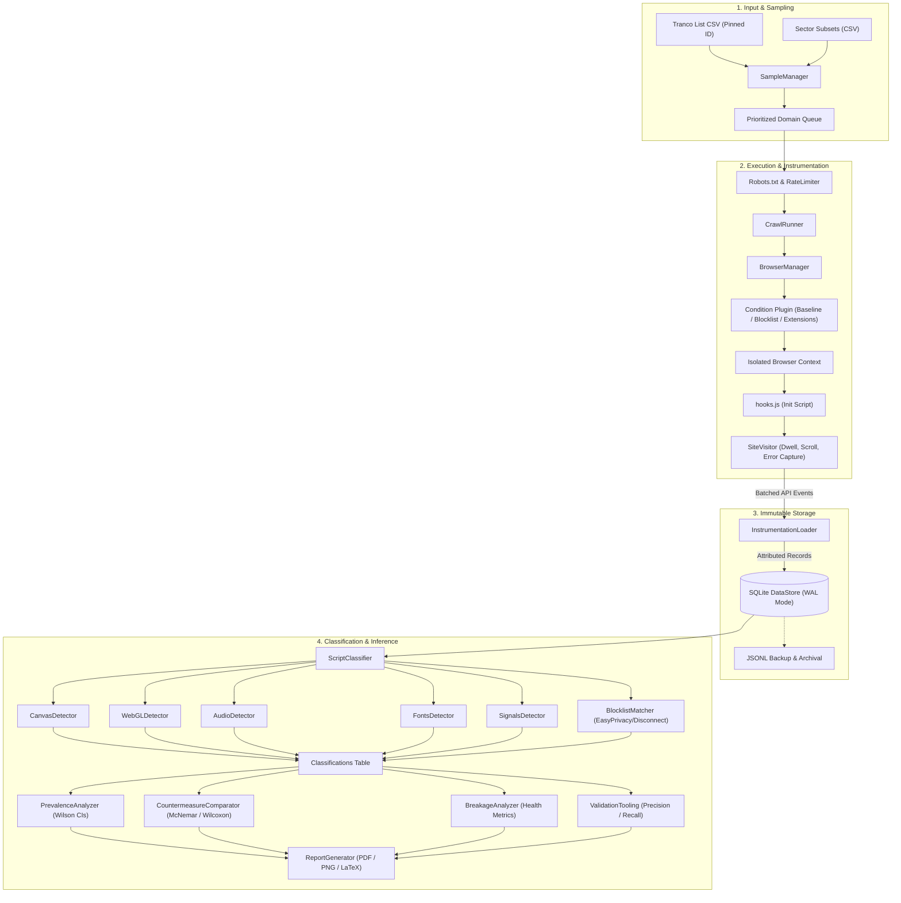

# Architecture and System Design (`docs/design.md`)

This document outlines the architectural design, component interactions, data pipeline, and technical rationale behind the Browser Fingerprinting Measurement Pipeline (`fpstudy`).

---

## 1. System Architecture Overview

The system is organized into modular layers with clear unidirectional data flow:
1. **Sampling & Politeness Layer:** Ingests and filters web domains, respects robots.txt restrictions, and applies token-bucket rate limiting.
2. **Instrumentation Layer:** Injects JavaScript API wrappers into Playwright browser contexts prior to document parsing.
3. **Crawler Orchestration Layer:** Manages isolated browser contexts, simulates realistic visit dwell times, enforces failure taxonomies, and handles run manifests.
4. **Storage Layer:** Appends immutable execution traces to a SQLite database configured in Write-Ahead Logging (`WAL`) mode.
5. **Detection & Classification Layer:** Evaluates rule-based heuristics across captured events per script and per domain.
6. **Analysis & Reporting Layer:** Conducts paired hypothesis testing and generates publication-grade figures and LaTeX tables.



---

## 2. Data Flow Pipeline

### 2.1 Instrumentation & Event Capture
1. When a browser context is created by `BrowserManager`, `InstrumentationLoader.inject(ctx)` invokes `ctx.add_init_script(hooks_js)`.
2. As scripts execute within the page (including inline scripts, external scripts, and sub-frames):
   - Hook wrappers intercept canvas rendering, WebGL queries, AudioContext synthesis, font probing, and supporting navigator/screen queries.
   - For every API call, an event is formed with:
     ```json
     {
       "visit_id": "v_12345",
       "ts": 12.34,
       "api": "canvas",
       "method_or_property": "toDataURL",
       "args_summary": {"width": 300, "height": 150},
       "return_summary": {"format": "image/png"},
       "script_url": "https://cdn.tracker.com/analytics.js",
       "stack_excerpt": "at Object.fp (https://cdn.tracker.com/analytics.js:14:20)",
       "frame_url": "https://example.com/",
       "top_level_url": "https://example.com/",
       "is_third_party": true
     }
     ```
   - Events are buffered in client-side memory (`window.__fpstudy_events`) and streamed to Python via Playwright's `page.expose_function("__fpstudy_push_events", ...)`.
   - On page dwell completion, a final buffer drain ensures zero event loss.

### 2.2 Script Attribution Engine
Attributing API calls to concrete scripts is essential for distinguishing first-party functionality from third-party tracking libraries:
- **Stack Trace Inspection:** When an API hook fires, it extracts `new Error().stack`.
- **Top Non-Hook Frame:** The top stack frame matching the internal hook script is popped.
- **Inline Scripts:** If the top frame points to the document URL itself or `<anonymous>`, the script URL is mapped to `inline:<sha256_hash>+<page_url>`.
- **Third-Party Classification:** Using `tldextract` with offline suffix snapshots, the effective top-level domain plus one (`eTLD+1`) of the script URL is compared against the top-level page origin.

---

## 3. Key Design Decisions & Alternatives Rejected

### Decision 1: Playwright over Selenium
- **Choice:** Playwright (Python async API).
- **Rationale:** Native support for `add_init_script` (guaranteed execution before any document script), automatic sub-frame instrumentation, built-in network request interception/routing (`context.route`), robust headless architecture (`--headless=new`), and direct devtools protocol bindings.
- **Alternatives Rejected:**
  - *Selenium WebDriver:* Cannot guarantee execution of init scripts before inline scripts in sub-frames; high crash rates in concurrent multi-context sessions.
  - *Puppeteer:* Node.js-based; would fragment the Python data analysis and statistical pipeline.

### Decision 2: Rule-Based Detectors over Machine Learning Classifiers
- **Choice:** Deterministic, transparent rule-based classifiers grounded in seminal peer-reviewed literature (Englehardt & Narayanan 2016).
- **Rationale:** Crucial for MSc dissertation defense. Every flag can be traced to verifiable evidence (e.g., "Script drew 14 distinct characters with 2 colors and read back canvas without save/restore").
- **Alternatives Rejected:**
  - *Machine Learning / Random Forest Classifiers (e.g., FP-Inspector):* Opaque decision boundaries, vulnerable to concept drift, and requires extensive pre-labelled training datasets that would risk student bias or unverified synthetic labels.

### Decision 3: SQLite WAL Mode over Flat JSON Files or Heavy RDBMS
- **Choice:** Single-file SQLite database configured with `PRAGMA journal_mode=WAL` and `PRAGMA synchronous=NORMAL`.
- **Rationale:** Provides transactional integrity, concurrent reader/writer support, indexing over millions of events, zero external service dependency (e.g. no Postgres daemon setup required), and straightforward sharing via a single file. Full JSONL export and import capabilities are provided for long-term archival.
- **Alternatives Rejected:**
  - *Raw JSON/JSONL only:* Inefficient queries when aggregating events per script across thousands of visits.
  - *PostgreSQL:* Unnecessary operational complexity for offline reproducibility and examiner replication.

### Decision 4: Plugin-Style Condition Registry
- **Choice:** `@register_condition("name")` decorator pattern subclassing `BaseCondition`.
- **Rationale:** Adding new experimental conditions (e.g. Brave, DuckDuckGo Privacy Essentials, Mullvad Browser) requires writing a self-contained module without touching the crawl orchestrator or data schemas.

### Decision 5: Separation of Raw Event Collection from Classification
- **Choice:** Raw events are stored immutably. Classification results are derived tables generated via `fpstudy classify`.
- **Rationale:** Enables iterating on detection thresholds, testing alternative heuristics, or conducting ablation studies without re-crawling live websites.
